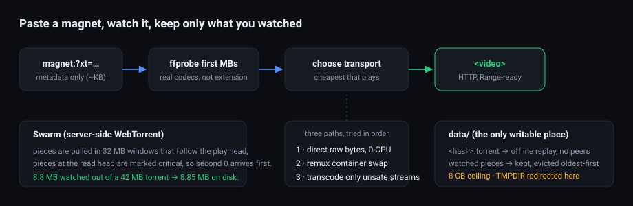

# webtorent

Paste a magnet link, watch the video in your browser. MKV, AVI, MP4 and friends.
Everything — code, temp files, downloaded video — stays inside this folder.



## Start it

Double-click **`start.command`** in Finder (it opens the browser for you), or:

```bash
npm start          # then open http://127.0.0.1:5173
```

First run only: `npm install`.

## Use it

1. Paste a magnet link (or a bare 40-character info hash) and press **Open**.
2. Pick the episode/file from the dropdown — the biggest video is preselected.
3. Press **Play**. The first pieces are downloaded first, so playback starts in
   seconds instead of waiting for the whole file.

While it plays you get live numbers: peers, download rate, how much of the file
is on disk, and how many seconds of video are buffered ahead.

## The player

The controls sit **on the picture** and fade away while you watch — move the mouse
(anywhere, including down to the bottom edge) and they come back. They stay put
whenever playback is paused, and never disappear mid-drag.

| Control | Shortcut |
|---|---|
| Play / pause (also click the picture) | `Space` or `K` |
| Back / forward 10 seconds | `←` / `→`, or `J` / `L` |
| Fullscreen (also double-click the picture) | `F` |
| Mute | `M` |
| Subtitles panel | `C` |
| Audio delay (A/V sync) | — |

The timeline shows three things at a glance: the played part in blue, how much is
reachable behind it, and the rest of the film. `−10` / `+10` and the arrow keys
work on real movie time, on every transport.

## Seeking, duration and the −10 / +10 buttons

The player shows the **full length of the movie** (e.g. `2:21:05`) the moment you
press play — it is read from the MKV/MP4 header, which is all that is needed to
know the runtime. You never see a duration that slowly grows as data arrives.

**Scrubbing.** Clicking the video bar, or using the `−10` / `+10` buttons, or the
`←` / `→` arrow keys (also `J` / `L`), all move the playhead:

* On a seekable source (MP4/MOV/WebM, or the finished seekable copy) the browser
  seeks natively and jumps instantly.
* On a still-downloading MKV/AVI the app re-opens the stream at the requested
  timestamp and lets ffmpeg jump straight to that keyframe — measured **55 ms** to
  start playing at 45:00.

**You can jump anywhere, and the app fetches that part on demand.** You are never
blocked waiting for the part of the film you skipped over:

* Clicking 09:00 in a film with only the first 43 seconds downloaded does **not**
  download the preceding nine minutes. The timestamp is mapped to a byte range,
  the byte range to a piece range, and only those pieces are pushed to the front
  of the swarm queue.
* ffmpeg reads the torrent **through the range-serving HTTP endpoint**, never the
  partial file on disk. This matters: a file with missing pieces reads back as
  zeros, so ffmpeg decodes garbage and never finds a picture. Over HTTP every seek
  is a `Range` request that the server answers by fetching exactly those pieces
  and holding the connection until they arrive.
* Matroska keeps its cue index at the end of the file, so the trailing few MB are
  pulled in alongside the target; without them ffmpeg cannot land on an exact
  keyframe.
* On a completed file there is nothing to fetch at all: the seekable copy is
  served over HTTP Range and a jump lands in **~5 ms**.

This is the same shape as the range-serving proxy in webtor's self-hosted stack:
byte range → piece range → prioritise → serve.

## What it does with each format

The app inspects the actual codecs (not just the file extension) and picks the
cheapest transport that will really play:

| Input | What happens | Cost |
|---|---|---|
| MP4 / MOV / WebM with H.264 + AAC, **index at the front** | **Direct** — raw bytes over HTTP Range, browser decodes and seeks it | none |
| MP4 with the **index at the end** (common for WEB-DL releases) | **Remux** — the browser has no index, no duration and no working seek bar until the whole file arrives, so it goes through ffmpeg instead | ~0% CPU |
| MKV / AVI / TS with H.264 8-bit + AAC | **Remux** — container swapped to fragmented MP4, streams copied | ~0% CPU |
| 10-bit H.264 (Hi10P anime), HEVC, DivX/XviD, AC-3/DTS audio | **Transcode** — only the unsafe streams are re-encoded | CPU, on the fly |

Measured on an M-series Mac: **44–55 ms** from pressing play to the first
decodable bytes, for both the remux and the transcode path. Playback is limited
by your swarm's upload speed, not by the conversion.

A 10-bit file that Chrome cannot decode at all comes out as 8-bit `yuv420p` and
just plays.

## Playback model: native on-demand (no seekable copy)

This app plays video **on demand, straight from the torrent while it downloads**.
There is no background "make seekable" conversion by default: that used to
launch a second full-file ffmpeg re-encode at ultrafast/4 threads, which pegged
the CPU, heated the Mac and starved the live playback stream of CPU — playback
buffered *because* of the seekable copy, not because of the swarm.

Seeking still works: for a still-downloading file the browser range-requests
exactly the pieces it needs (`/raw/`), the server fetches them on demand, and
the player shows how far it can currently play. Native/direct MP4 and remuxed
MKV need almost no CPU; only codecs the browser cannot decode (e.g. 10-bit HEVC
with E-AC-3 audio) require a live transcode — one ffmpeg at a time, killed as
soon as playback stops or the page reloads.

If you ever want the old behaviour back, start with `ENABLE_SEEKABLE_COPY=1`
(it re-enables auto-upgrade and the "Make seekable" button).

## Audio out of sync?

The app does not shift the audio. Measured with a flash-and-tone marker through
every conversion path it can use:

| Path | A/V offset |
|---|---|
| Source file (baseline) | +5 ms |
| Live remux to fragmented MP4 | −13 ms |
| Seek remux | +5 ms |
| Transcode | −13 ms |
| Progressive MP4 repair | audio **and** video byte-identical |

All within one video frame, and below the AAC priming delay every player has.

If it still sounds off, it is almost always one of two things:

* **The release itself** — some WEB-DL and DVDScr sources are authored slightly
  out of sync. Nothing on the server can know that.
* **Your output device** — Bluetooth headphones and HDMI/TV audio add 150–300 ms,
  and browsers do not compensate the way a dedicated player does.

Press **A/V** in the player to fix either case: `−50 ms` / `+50 ms` (up to ±5 s)
delays the audio to line it up, and **Reset** returns to zero. Positive values run
instantly in the browser; negative values (audio ahead of the picture) are baked
into the live converter on the next stream start — native/direct streams keep
the note "remembered but not applied".
The audio is routed
through Web Audio only once you actually use a positive control, so nothing is touched
otherwise.

**The delay is remembered per video, not per torrent.** In a split-scene release
each scene can be authored with its own offset, so one global value would fix one
scene and break the rest. Each file's value is stored in its library entry and
reapplied automatically the next time you play it — including after a restart.

## Downloads start immediately

Adding a magnet used to fetch **metadata only** - the swarm stayed idle until you
pressed Play, and only then began finding peers and ramping up from zero. The
largest video file is now selected as soon as the metadata lands, so the ramp
happens while you are still choosing a file:

| | Before | Now |
|---|---|---|
| Download on add | nothing | **starts at once** |
| Speed at 12 s | 0 | **1.9 MB/s** |
| Progress after 20 s, untouched | 0% | **21%** |

Only the largest video is selected, so a season pack still does not pull every
episode. Set `AUTO_DOWNLOAD=0` for metadata-only behaviour.

Two bugs were behind the old behaviour:

* **`torrent.ready` is false immediately after the `metadata` event** - WebTorrent
  only sets it once the store exists. Priming *and* index-warming both checked
  `ready` straight after metadata, saw `false`, and silently did nothing. They now
  wait for the real `ready`.
* **uTP is off by default.** Its native module emitted an unhandled
  `UTP_ECONNRESET` that kills the process mid-film, and it found *fewer* peers than
  TCP (13 vs 25) for the same throughput. Set `ENABLE_UTP=1` if a swarm needs it.

## Speed and buffering on high-bitrate video

Four things decide whether a 1080p+ film plays without stalling. All four are now
tuned, and the first one mattered by far the most.

**1. Trackers - the single biggest lever.** A magnet's own tracker list is often
dead, and a bare info hash has none at all. The app now ships the
[ngosang best-trackers list](https://github.com/ngosang/trackerslist) (22 live
trackers) and concatenates it with whatever the magnet carries. Measured on the
same torrent: **peers went from 1-3 to 22-42, and speed from 452 B/s to 0.5-5.1
MB/s**. Peer count is what everything else depends on.

**2. Adaptive read-ahead.** The download window is no longer a fixed 180 s. It is
sized from the ratio of measured swarm speed to the film's own bitrate
(`size x 8 / duration`), so the buffer grows faster than playback consumes it:

| Situation | Window |
|---|---|
| 8 Mbps film, 20 MB/s swarm (2.5x headroom) | 180 s |
| 8 Mbps film, 8 MB/s swarm (1.0x) | 360 s |
| 20 Mbps film, 5 MB/s swarm (0.25x) | 720 s |

When the swarm cannot keep up, the window goes as deep as it can - that head start
is the difference between a stall and a pause you never notice. Tune with
`BUFFER_AHEAD_SECONDS` / `BUFFER_AHEAD_MAX_SECONDS`.

**3. Hardware decoding.** Decoding a high-bitrate stream in software steals CPU
from the encoder. `-hwaccel videotoolbox` took a 12 Mbps 1080p HEVC transcode from
**10.9x to 16.4x realtime**. Disable with `DISABLE_HWACCEL=1` if a source misbehaves.

**4. Match the encode to the source.** A seekable copy is capped near the source's
own bitrate, so it cannot balloon (an early version produced a 7.2 GB copy from a
2.2 GB film).

If a film still stalls, the swarm is delivering less than its bitrate - that is
arithmetic, not a setting. Check the `↓` chip against `size / duration`: for 1080p
that is typically 4.5-8 Mbps ([Mux's ladder](https://www.mux.com/articles/adaptive-bitrate-streaming-how-it-works-and-how-to-get-it-right)).

## Why a film can buffer even at 100% downloaded

If the status shows **`file 100%`** and a **very low `↓` speed**, the download is
finished - nothing is being fetched. Buffering at that point means the **converter**
is the bottleneck, not the swarm.

That happens when the video needs re-encoding (HEVC, 10-bit H.264, DivX): the
picture has to be decoded and re-encoded **faster than realtime** or the player
starves. Measured on a 1080p source:

| Setting | Speed |
|---|---|
| `libx264 -preset veryfast` | ~2.4× realtime |
| `libx264 -preset ultrafast` | **~3.7× realtime** |
| `h264_videotoolbox` (hardware) | ~1.1–1.5× realtime |

Hardware encoding is *slower* here, so the live streaming paths use
`ultrafast` - headroom is what prevents buffering - while one-off conversions to
disk keep the better-looking `veryfast`, since they have no deadline. Override with
`TRANSCODE_PRESET` / `PREPARE_PRESET`.

The permanent fix is a **seekable copy**: the film is converted once, after which
playback and seeking are native and need no encoder at all. A live conversion makes
the browser treat playback as a *live stream*, which it buffers very conservatively -
that is the "buffering…" that appears even when the file is 100% downloaded and the
encoder is running 30x realtime.

A re-encode is a full pass over the film, so the app measures the rate as it goes and
shows an estimate in the player. Re-encodes default to the fast preset (~41 min for a
2.6-hour 1080p feature, versus ~75 min for the quality preset); if the measured rate
says the whole thing would still exceed `PREPARE_BUDGET_MS` (default 90 minutes) it
retries once at the fastest preset, and only then gives up - rather than burning the
CPU for hours without saying so. Override with `PREPARE_PRESET`.

## Subtitles

Press **CC** (or `C`) in the player for the subtitle panel.

**Tracks already inside the file** are listed automatically and need no account or
API key. They are converted to WebVTT on first use and cached in `data/.subs/`, so
switching back is instant. Bitmap formats (BluRay PGS, DVD VobSub) are shown but
marked *bitmap* — they are pictures, not text, and cannot become WebVTT without OCR.

**OpenSubtitles** search and download needs a free API key
(<https://www.opensubtitles.com/en/consumers>). Put it in a `.env.local` file next
to `server.js` — it is gitignored, so the key never ends up in the repo:

```
OPENSUBTITLES_API_KEY=your-key
```

Or pass it inline for a single run:

```bash
OPENSUBTITLES_API_KEY=your-key npm start
```

An environment variable always wins over `.env.local`, so the inline form is handy
for testing a different key. Once set, the panel gains
a search box: it is pre-filled with the title guessed from the file name
(`www.Site.com - Some Movie (2024) 1080p WEB-DL x264-GROUP.mkv` becomes
`Some Movie 2024`), which you can edit. Results show the release name, language and
whether they are hearing-impaired; **Get** downloads, converts to WebVTT, caches it
next to the video and switches it on.

Downloaded subtitles are listed under the embedded ones and can be removed with the
✕ button. Nothing is sent anywhere except the title you search for.

**Subtitles bundled in the torrent** (a `Subs/English.srt` next to the video) are
listed as *sidecar* tracks and win over downloads: they are timed for this exact
release, so they are the least likely to drift. They convert to WebVTT on first
use and cache like embedded tracks.

**Timing** — every track carries its own offset and drift correction, saved per
video file. The **− 50 ms / + 50 ms / Reset** buttons in the subtitle panel shift
that track earlier or later (up to ±60 s); the **Drift** selector rescales for
frame-rate mismatches (24 ↔ 23.976, 25 ↔ 24) where timings fall further out the
longer the film runs. Browsers expose cues read-only, so the server rewrites the
track on the fly (`/subs/…?offset=…&scale=…`) — the picture position never moves.
Selection and offsets are restored on play, across stream switches and restarts;
explicitly choosing **Off** is remembered as off. Search results are re-ranked
for this release (resolution/source match first, download count as tie-break) so
the top result is the right version, not just the most popular one.

## Space: only what you watch

This is the part that keeps the folder small.

* Adding a magnet downloads **metadata only** — a few KB. A 60 GB season pack
  costs nothing until you press play.
* Only the file you selected is fetched; samples, `.nfo`, subtitles and other
  episodes are never downloaded.
* Video is read in **32 MB windows**, so the download follows your play head.
  Verified: streaming one 8.8 MB video out of a 42 MB torrent downloaded
  **8.85 MB** — the 30 MB extra payload in the same torrent stayed at 33 KB.
* A hard ceiling on the whole data folder (**8 GB** by default). When it is
  reached, the oldest items are deleted automatically; the one you are watching
  is never touched. A banner tells you when the cap is hit.

Want the whole file instead? Press **Keep full file**. Want to scrub through it?
Press **Make seekable** — that converts the finished file once into a faststart
MP4, after which seeking is instant and needs no ffmpeg at all.

Nothing is deleted unless you ask: use **Delete data from disk** (one item) or
tick **Delete when playback ends**.

## Library

Anything you have opened is listed at the bottom with its size on disk and where
you stopped watching. Because the `.torrent` metadata is saved next to the video,
**Play** re-opens a saved item instantly from disk — no peers, no trackers, works
offline. Positions are stored as you watch, and resume automatically for formats
that can seek.

## Where everything lives

```
webtorent/
├── data/                      ← the only place anything is written
│   ├── <infoHash>.torrent     saved metadata (makes offline replay possible)
│   ├── <infoHash>.json        library entry: files, resume position, size
│   ├── <torrent name>/…       the video pieces you have actually watched
│   ├── .seekable/<hash>/…     optional faststart MP4 copies
│   └── .tmp/                  temp files (TMPDIR is redirected here)
├── public/                    the web UI
├── lib/                       torrent, probing, ffmpeg and storage logic
└── node_modules/              dependencies
```

The Node process also sets `TMPDIR`, `TMP` and `TEMP` to `data/.tmp` *before*
loading WebTorrent, so no dependency can drop files in `/var/folders`. Nothing
is installed globally and no system directory is touched.

## Configuration

Set these before `npm start` (all optional):

| Variable | Default | Meaning |
|---|---|---|
| `PORT` | `5173` | HTTP port |
| `MAX_DATA_GB` | `8` | Hard ceiling for the whole `data/` folder |
| `MAX_PREPARE_GB` | `4` | Largest file allowed to get a seekable copy |
| `WINDOW_MB` | `32` | Read-ahead window per stream |
| `PREFETCH_WINDOW_MB` | `48` | Priority window handed to the swarm |
| `MAX_CONNS` | `160` | Peer connection limit |
| `METADATA_TIMEOUT_MS` | `90000` | How long to wait for metadata before giving up |
| `SESSION_IDLE_MINUTES` | `45` | Idle torrents are released after this |
| `SEEK_FETCH_TIMEOUT_MS` | `90000` | How long a forward seek waits for its pieces |
| `THROTTLE_DOWNLOAD` / `THROTTLE_UPLOAD` | off | Bytes/second caps, for metered links |
| `FFMPEG_PATH` | `ffmpeg` | Use a specific ffmpeg binary |
| `OPENSUBTITLES_API_KEY` | off | Enables OpenSubtitles search and download |
| `TRANSCODE_PRESET` | `ultrafast` | x264 preset for live streaming |
| `BUFFER_AHEAD_MAX_SECONDS` | `1200` | Ceiling for the adaptive read-ahead window |
| `DISABLE_HWACCEL` | off | Set to `1` to force software decoding |
| `AUTO_DOWNLOAD` | on | `0` restores metadata-only (nothing downloads until Play) |
| `ENABLE_UTP` | off | `1` re-enables the uTP transport |
| `PREPARE_PRESET` | `veryfast` | x264 preset for one-off conversions |

## Troubleshooting

**"No peers answered within 90s"** — the torrent is dead, or your network blocks
trackers/DHT. Magnet links with more `tr=` trackers work better.

**Playback stalls** — check the peer count and download rate in the stats bar. If
peers exist but the rate is near zero, the swarm has no seeders. The player falls
back automatically (direct → on-the-fly conversion) and tells you when it does.

**"ffmpeg missing"** in the header — `brew install ffmpeg`. Without it only MP4,
MOV and WebM can play; MKV/AVI cannot be converted.

**Seeking does nothing on an MKV** — a live-converted stream has no seekable
index by design. Press **Keep full file**, wait for 100%, then **Make seekable**.

**Storage limit reached** — delete items from the library, or start with a bigger
`MAX_DATA_GB`.

## How it works

* **Server-side WebTorrent** (`lib/torrents.js`). The browser never talks to the
  swarm; the Node process does, and serves the video over plain HTTP.
* **Head-first windows** (`lib/streaming.js`). A single long read stream would
  register a selection covering the entire file, and WebTorrent downloads every
  selected piece — that is how a "streaming" app quietly eats your disk. Instead
  each 32 MB window is its own read stream, so its selection is released when the
  window is consumed; one window is pre-opened as read-ahead. Pieces nearest the
  read head are additionally marked `critical`, which is what makes the swarm
  serve the opening seconds first.
* **Codec-aware transport** (`lib/media.js`, `lib/probe.js`). ffprobe reads just
  the first few MB to learn the real codecs — which also warms the exact bytes
  playback needs — and the plan decides between raw bytes, a remux, or a targeted
  re-encode.
* **Live fMP4** (`lib/ffmpeg.js`). `empty_moov` + `frag_keyframe` +
  `-tune zerolatency` means a playable fragment is emitted within milliseconds
  and the browser can start before the file finishes converting.

## Tests

```bash
npm run fixtures          # build small MKV test clips with ffmpeg
npm run seed              # start a local tracker + seeder, prints a magnet
npm run ui-test           # drive the real UI: playback, pause/resume, ±10s
node test/buffer-watch.mjs "" 60    # sample buffer + stalls over 60s
node test/codec-probe.mjs <file>    # can this browser decode it at all?
```

`buffer-watch` prints the buffer, position and `waiting`/`stalled` counts every two
seconds, so "it buffers" becomes a measurement rather than a guess. `codec-probe`
answers whether a codec needs converting on this machine in the first place - it is
how HEVC was confirmed unsupported here.

`test/ui-seek.mjs` drives the **real UI** in a headless Chrome over the DevTools
Protocol: it clicks the library's Play button, waits for playback, then exercises
pause/resume and the `-10` / `+10` buttons, reporting the on-screen clock. It
measures what the viewer sees rather than the element's own `currentTime`, which
restarts at 0 for every live stream and is therefore misleading.

`test/seeder.mjs` serves the fixtures from a private tracker on localhost, so the
whole pipeline can be exercised without touching the public swarm.
